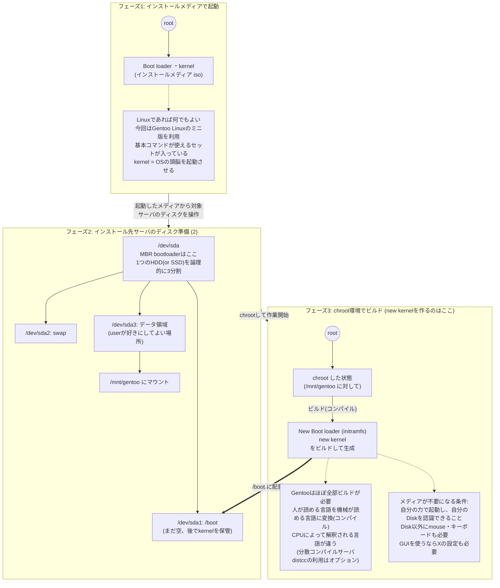
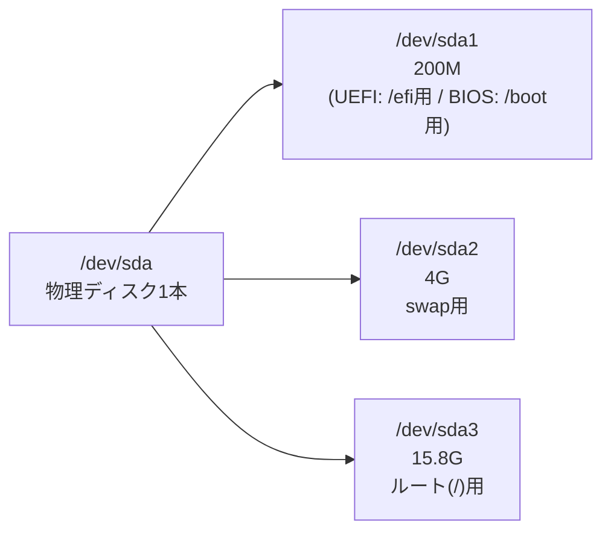
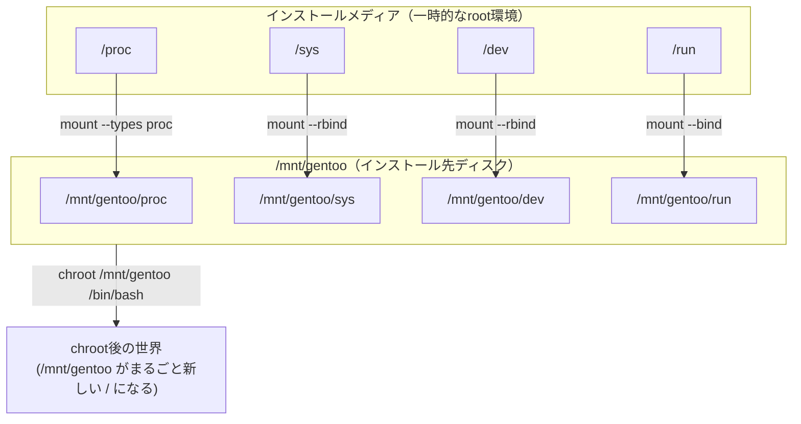
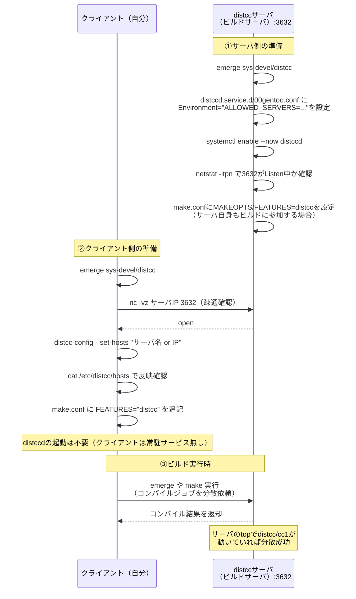
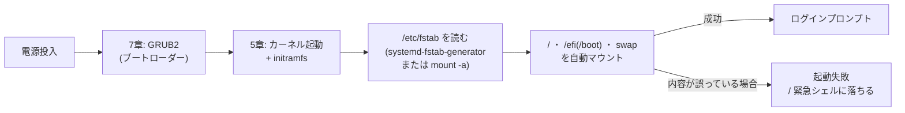
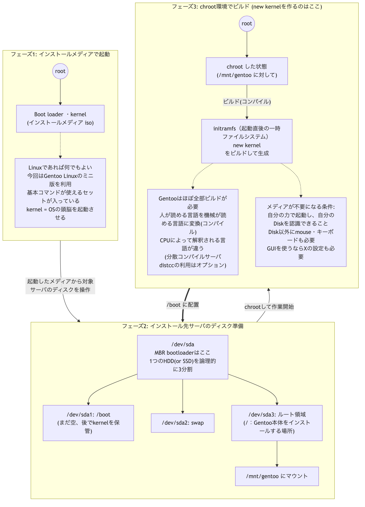

# 勉強会: Gentoo Linuxで学ぶハンズオン

## Gentoo Linux インストール ハンズオン

### **Gentoo Linux インストール メモ**

#### **0. 概要とダウンロード**

- **マニュアル:** [Gentoo Linux のインストールについて](https://wiki.gentoo.org/wiki/Handbook:AMD64/Installation/About/ja)
- **インストールイメージ（iso / アイエスオー / イソ）:**
    - iso（インストールイメージ）を用意する
    - isoのファイル形式は「イメージファイル」といわれていて、昔はDVD/CDとかに焼きつけて初めて中身が見れるものだった。
    - 時代の変化とともにいちいち焼くのはめんどくさくなってきて、isoのまま焼かずに中身を見れる仮想ツールが発達した。そのため、今は焼くこと無しに利用するのが一般的。
- **入手先:** 国内のミラーサーバ（Ringサーバともいう。コピーが世界中に置かれている）を使う。日本にあるので速い。
    - http://ftp.iij.ad.jp/pub/linux/gentoo/releases/amd64/autobuilds/current-install-amd64-minimal/
    - 対象ファイル例: install-amd64-minimal-20230129T164658Z.iso
    - Linuxはただで入手できるものが多い。世界中にダウンロードするためのサーバが分散されており、どこぞの大学のサーバ or どこぞのでっかい通信系のデッカイサーバで「無料でどうぞ」となっている。

##### **CPUの種類とベンダー（ITの世界でのメーカーのこと）**
CPU（チップ、プロセッサ）が違うとおしゃべりできる機械の言葉が違うため、動いているソフトやアプリが動かない。（例：iPhone用とAndroid用のLINEは見た目や機能は一緒でもプログラムは全く別もの）。 プロセッサがコンピュータの性能をだいたい決め、速ければ速いほど処理速度が速い。

- **Intel（インテル）:** 「インテル、入ってる♪」のCMのアレ。世界中のパソコンとサーバに入っている。Core i7, Core i5, Xeon（じーおん）。
- **AMD:** Ryzenシリーズ。IntelとAMDはベンダーが違うが100%互換性（プログラムが動く）がある。
    - **【重要】** amd64/ がIntelとAMDのことで、今回の正解。
- **Apple:** Mac、iPhone。M1, M2, M3, M4（Apple Silicon）。ARM系。
- **ARM:** 日本人であればソフトバンクが2016年に買収した。Chromebook、Raspberry Piなど。QualcommのSnapdragon（Androidスマホに搭載）もARM系。

##### **全体の流れ（図解）**
インストールの全体像をMermaidで整理したもの。



---
#### **1. 一時的なroot環境（LiveCD / 仮想環境での起動）**
##### **1.1 Proxmox 等での起動とファームウェア**
Proxmox の Web 管理画面（例: `https://proxmox.example.local/`）にログインする。

（環境によっては SSO 等でログインする）
> （※ Proxmox 管理画面のスクリーンショットは省略）

起動する時に一番最初に読み込まれる領域（ファームウェア）は2択：

- **BIOS（バイオス、MBR）:** 一般的なPC（DELL等で電源を入れてすぐにF2やDELLキーを連打すると立ち上がるやつ）。10年前のパソコン等に利用されていた。VirtualBox、VMWare、Xen、KVMなどの仮想系コンピュータでは今でもこれが利用されている。ローカルディスクにBIOS関連の領域は無い。
- **UEFI（efi、efs、GPT）:** 新しい。ここ5年くらいの電気屋さんで売ってるPCや最新のサーバはこれ。UEFI自体にbootできる機能（bootloader）がある。ローカルディスクにEFSというフォーマットの領域を持つ。（ESXi version 8ではデフォルトがEFI）。

##### **1.2 ネットワークの疎通確認と設定**

- ProxMoxのVMのネットワーク設定
> （※ Proxmox VM のネットワーク設定画面のスクリーンショットは移植時点で取得できなかったため省略）

`ip a` を実行して 169.xxx と表示されたら、そのIPはデタラメで通信できない。 DHCPであれば自動的に 192.xxx などが振られるが、今回は自分達でIPを指定したいので手動設定する。

- **TUI/GUI/CUIの違い:** 今回はCUI/TUIでの操作。
- **ネットワーク設定情報（IPアドレス管理表より）:**
    - ネットワーク帯: 192.168.0.0
    - ネットマスク: 255.255.255.0
    - ゲートウェイ: 192.168.0.1
    - DNS: 192.168.0.10
- **コマンドによる設定（OSを再起動すると設定は飛びます）:** `ip a` で lo とは別の認識しているNIC（Network Interface Card。LANケーブルが刺さる部品）の名称を確認。

```bash
# IPとネットマスク（プレフィックス）の設定
ip address add 192.168.0.50/24 dev ens18

# デフォルトゲートウェイの設定
ip route add default via 192.168.0.1

# 確認コマンド（なにか表示が出たらOK）
ip route

# DNS設定（書き込まれていることを cat で確認）
echo "nameserver 192.168.0.10" > /etc/resolv.conf
cat /etc/resolv.conf

# 疎通確認
ping yahoo.co.jp
```

##### **1.3 SSHサーバーの起動**
今回はisoの中に最初からsshサーバが入っているのでインストールは不要。`netstat -ltpn` で 22番portが立ち上がっていないとsshできない。

- **Linuxのサービス起動方法の歴史:**
    - **SysVinit (OpenRC):** 20年前〜10年前くらい。一部現役。SystemV系(unix)のAIX, Solaris, BSDなど。GentooのインストーラCDはこれ。
        - コマンド: `/etc/init.d/ssh start` または `rc-service sshd start`
    - **upstart:** 10年前かつDebian系のみ。覚えなくてよい。
    - **systemd:** 最近のLinuxは全部コレ。
        - コマンド: `systemctl start sshd`
- **SSH接続のための準備:** `id` コマンドで root であることを確認し、rootのパスワードを決める。

```bash
passwd
```

- **各担当のIPアドレス候補（例）:**
    - 192.168.0.150 : user1-gentoo
    - 192.168.0.151 : user2-gentoo
    - 192.168.0.152 : user3-gentoo
- **サービス起動と確認:**

```bash
rc-service sshd start
netstat -ltpn   # 22 port が Listen したことを確認！
```

---
#### **2. ディスクの準備（パーティショニング・フォーマット）**
##### **2.1 パーティショニング（土地の分割）**
fdisk コマンドを使い、認識しているディスクを確認する。

```bash
fdisk -l
# ※ /dev/ramXX と /dev/loopXX は無視。残った /dev/sda を対象とする（lsblk も併用して確認）。
```

- **ディスクラベルの組み合わせ:**
    - GPT（GUIDパーティションテーブル） ＋ UEFIブート（現代のハードウェアで強く推奨）
    - MBRパーティションテーブル ＋ レガシーBIOSブート
- **fdiskによる操作:**

```bash
fdisk /dev/sda
```

- p : 今どうなっているか確認（lsみたいなもの）。デフォルトが dos（BIOS用）の場合、新しいGPTラベルを作成するために g を入力して Disklabel type: gpt にする。
- n : 新しいパーティションを作る。
- t : パーティションの種類（Id）を変更する（1: EFI、82: Linux swap 等）。
- w : 書き込み。

**【最終的なパーティション目標構成】**
```text
Device         Start       End  Sectors  Size Type
/dev/sda1       2048    411647   409600  200M Linux filesystem
/dev/sda2     411648   8800255  8388608    4G Linux swap
/dev/sda3    8800256  41940991 33140736 15.8G Linux filesystem
```

1つのディスクを3つに切り分けている状態を図にすると、以下のようになる（この後の2.2フォーマット・2.4マウント・6.1 fstabで、すべてこの3分割を前提に話が進む）。



##### **2.2 フォーマット（土地を綺麗に耕して家を建てる基礎を作る）**
土地を分割しただけではデータは読めない。同じHDDでもTV用フォーマットのものはPS4ではそのまま読めないのと同じ。フォーマットするとそれ以前のデータは全て消え、ファイルシステムが作られる。

- **Windows用:** fat, fat32, ntfs, exFAT
- **Mac用:** exFAT, APFS
- **Linux用:** (めちゃ昔のlinux はEXT2, EXT3) EXT4, XFS, ReiserFS（何もこだわりが無ければEXT4でよい。落合が好きなのはOpenZFS）。

※同じOSでもフォーマット複数あるのはなぜ？ ＝仕様が違う（取り扱うサイズとか、ジャーナル機能有無とか）

```bash
# 1. EFI環境の場合のESPフォーマット (FAT系列でないとUEFIがブートローダーを見つけられない)
mkfs.fat -F32 /dev/sda1

# 2. ルート領域のフォーマット (Linuxが得意とする形式)
mkfs.ext4 /dev/sda1
mkfs.ext4 /dev/sda3
```
※EFI環境: Proxmoxで構築時に「UEFI」を選択した場合

##### **2.3 メモリの仕事とSwap（スワップ）**
CPUが命令を出してデータを読み込む時、毎回diskからだと遅いので何倍も速いメモリから読み出す。メモリが足りなくなると「OOM (OutOfMemoryKiller)」が起き、メモリを使っているプログラムを勝手に殺す。

- **Swap領域:** メモリが溢れた時に代わりに使われる領域（所詮はdisk上の偽物）。ぶっちゃけて言うと、金があれば本物のメモリを使えばよいというだけの話。

```bash
mkswap /dev/sda2   # スワップ領域の作成
swapon /dev/sda2   # スワップの有効化（再起動すると解かれる）

# 確認コマンド
free -m
swapon -s
```

##### **2.4 マウント（mount）**
フォーマットした領域はマウントしないと読み書きできない。df -Th で現在の状況、空き容量、フォーマットの種類を確認できる。

```bash
mount /dev/sda3 /mnt/gentoo
df -Th
```

#### **3. Stage Tarballのインストールと初期設定**
##### **3.1 時刻同期とStage3のダウンロード・解凍**

- **時刻を合わせる:**

```bash
chronyd -q
```
- **プロキシの設定（必要に応じて※Proxmoxだと必要）:**

```bash
export http_proxy="http://proxy.example.local:3128"
export https_proxy="http://proxy.example.local:3128"
```

- **Stage3（基本的なファイルが入ったターボール。Linuxでメジャーな圧縮形式）の入手と展開:**

```bash
cd /mnt/gentoo
wget http://ftp.iij.ad.jp/pub/linux/gentoo/releases/amd64/autobuilds/current-stage3-amd64-systemd/stage3-amd64-systemd-20260712T170110Z.tar.xz

# 解凍コマンド
tar -xpvf stage3-*.tar.xz --xattrs-include='*.*' --numeric-owner
```

##### **3.2 コンパイルオプションの設定（/etc/portage/make.conf）**
人間が理解できる言葉を機械が理解できるように変換することをコンパイル（ビルド）という。逐次変換する「インタプリタ」と、最初に一気に変換する「コンパイラ」の2種類がある。Gentooではこのビルドのチューニングを make.conf で行う。

```bash
vi ./etc/portage/make.conf
```

- **MAKEOPTS="-j5"**: ビルドの並列数を決める。目安は「CPUのコア数 + 1」。コア数は `cat /proc/cpuinfo` や `nproc` コマンドで確認できる。
- **-l10**: ロードの上限（ロードが10になるまで頑張る設定）。
- **CFLAGS="-march=native"**: gcc4.0以上からx86_64で選べる。何も考えなくても最適なコンパイルオプションを自動選択してくれる。
    - > ⚠️ **【重要】distccを使う場合は要注意:** 「native」は実際にコンパイルするマシン基準で決まるため、別サーバで並列コンパイルする「分散コンパイル（distcc）」では-march=nativeが使えず、ガチで設定を書き換える必要がある。
    - 以下のコマンドで `-march=` から `-mtune=` までを確認して COMMON_FLAGS に書き換える（下記ファイル例を参照）。

```bash
gcc -v -xc -march=native /dev/null 2>&1 | grep cc1
```
- **CXXFLAGS**: CFLAGS と同じ値を設定する。
- **USE変数**: 独自の機能ON/OFF設定。マイナス（ハイフン）をつけると機能を外す意味になる。
    - 設定例: USE="-X -gtk -gnome -qt5 -kde -dvd -alsa -cdr" （デスクトップ環境やマルチメディア関連のコンポーネントを外す）。
- **リポジトリのミラー設定（Mirrorselect）:**

```bash
mirrorselect -i -o >> /mnt/gentoo/etc/portage/make.conf
```

---
#### **4. Chroot（チェンジルート / Jail監獄環境）**
##### **4.1 仮想ファイルシステムのマウントと移行**
クライアント側の仕組みであるDNSリゾルバ設定（/etc/resolv.conf）をコピーし、各ディレクトリをマウントしてchrootする。

```bash
cp -p /etc/resolv.conf /mnt/gentoo/etc/

mount --types proc /proc /mnt/gentoo/proc
mount --rbind /sys /mnt/gentoo/sys
mount --make-rslave /mnt/gentoo/sys
mount --rbind /dev /mnt/gentoo/dev
mount --make-rslave /mnt/gentoo/dev
mount --bind /run /mnt/gentoo/run
mount --make-slave /mnt/gentoo/run

# ---- SSHログインしたら以下から実施 ----
chroot /mnt/gentoo /bin/bash
source /etc/profile    # または . /etc/profile （意味は一緒）
export PS1="(chroot) ${PS1}"

# UEFIの場合のマウント
mkdir /efi
mount /dev/sda1 /efi

# (※BIOSの場合のマウント例: mount /dev/sda1 /boot)
```

`mount --rbind` / `--bind` の4行は、今動いているインストールメディア（一時的なroot環境）が持っている `/proc` `/sys` `/dev` `/run` を、そのまま `/mnt/gentoo` 配下にも見せかけるための処理です。これをやらずに `chroot` すると、新しい環境の中でハードウェア情報やプロセス情報が空っぽになり、`emerge` やカーネルビルドがまともに動きません。図にすると以下のような関係です。



`chroot` した瞬間、これらのbind mountのおかげで「ディスクの中身だけ入れ替わったが、ハードウェアやプロセスは今動いているマシンのものがそのまま見える」という状態になります。

ここからは **【実際の環境（chroot内）】** での作業です。
##### **4.2 Portage（パッケージ管理）と基本設定**

- **パッケージリストの更新 (Debianの apt update 的なやつ):**

```bash
export https_proxy=http://proxy.example.local:3128
export http_proxy=http://proxy.example.local:3128
emerge-webrsync
```

- **Eselectによるプロファイル選択:** システムの標準環境を簡単に変更できるGentooのツール（Debian/RedHatでいう update-alternatives 的なもの）。

```bash
eselect profile list
eselect profile set 2
```

- **エディタのインストール:** chroot直後は vim がまだインストールされていない（使えない）のでインストールする。

```bash
emerge -av vim
```

- **CPUFLAGSの設定 (cpuid2cpuflags):** apt install と意味が一緒のGentoo版コマンド emerge を使用。

```bash
emerge -av app-portage/cpuid2cpuflags
cpuid2cpuflags
echo "*/* $(cpuid2cpuflags)" > /etc/portage/package.use/00cpu-flags
cat /etc/portage/package.use/00cpu-flags
```

##### **4.3 タイムゾーンとロケール（地域・言語環境）の設定**

- **タイムゾーン:** 標準はイギリスのグリニッジ天文台（日本は+9時間）。`ls /usr/share/zoneinfo/Asia/Tokyo` を確認してシンボリックリンクを貼る。

```bash
ln -sf /usr/share/zoneinfo/Asia/Tokyo /etc/localtime
ls -l /etc/localtime   # リンク確認
date                  # 日本時間（JST）になっているか確認
```

- **ロケール:** 地域設定のこと。最近のLinuxは全てUTF8。 /etc/locale.gen を開き、ja_JP.UTF-8 UTF-8 の先頭の #（コメント）を外して有効にする。

```bash
locale-gen             # 言語セットの生成
eselect locale list

eselect locale set 170   # ja_JP.utf8 に変更

# 環境のリロード（date が日本語表示になる）
env-update && source /etc/profile && export PS1="(chroot) ${PS1}"
```

---
#### **5. カーネルのビルド（心臓部分）**
##### **5.1 ソースの準備**
emerge コマンド（RHELの yum install / dnf install、Ubuntuの apt install と同じような感じのやつ）でカーネルソースを入れる。

```bash
emerge -av sys-kernel/gentoo-sources
# これにより /usr/src/ の下にソースが準備される。
eselect kernel list
eselect kernel set 1
cd /usr/src/linux
```

##### **5.2 .config（設計図）の作成方法（3種類）**

- **ガチ手動:** いきなり make menuconfig や、その改良後発版の make nconfig を実行し、マニュアル（VirtualBoxのWiki等）を読みながら作る。
- **セミオート（ほぼ全自動） ★今回採用★:** make localyesconfig を実行する。現在動いているLiveCDのisoが知っている・動かせているドライバーをそのまま引き継ぐため、新しいカーネルもきっと動く。「全知全能のLiveCDカーネルさんが必要だと言っているものだけをyesにする」超おすすめのやり方。デメリットは、何でもかんでもカーネル内にモジュール内包してしまう点。
- **全自動（genkernel）:** Gentoo特有のツール。一般的なOS（Windows, Mac, 一般的なLinuxディストリ）のように、何でも動く全知全能のカーネルを作る。デメリットは無駄だらけな点。

**セミオートの別ルート：現行カーネルの設定を引き継ぐ**

新しいカーネルをビルドする際、既に動いている現行カーネルの設定を土台にして「差分だけ」設定する方法。

```bash
cd /usr/src/linux

# 現行カーネルの設定を引き継ぐ（どちらか片方でOK）
zcat /proc/config.gz > /usr/src/linux/.config
# または
cp /boot/config-6.1.19-gentoo-x86_64 /usr/src/linux/.config

# 引き継いだ設定をベースに、新しいカーネルソースで増えた設定項目だけ対話的に答える
make oldconfig
```

- `make oldconfig` は、引き継いだ `.config` と新しいカーネルソースとの差分（新規追加された設定項目）だけを1つずつ質問してくる。既存の設定値はそのまま維持される。
- **「とりあえず全部デフォルトでいい」場合:**

```bash
# oldconfig の質問全てにデフォルト値で自動回答する
make olddefconfig
```

- **`make menuconfig` / `make nconfig` は `oldconfig` と同じ役割になるのか？** → ならない。役割が異なる。
  - `menuconfig` / `nconfig` は、既存の `.config` があればそれを土台として読み込みつつ、**設定項目全体をメニューUIで一覧・編集**できるフル対話型ツール（新規・既存を問わず全項目を自由に触れる）。
  - `oldconfig` は非対話寄りのUIで、**新しいカーネルバージョンで新規に増えた設定項目だけ**を1問ずつ質問する。既存設定の見直しはしない、「差分だけ埋める」ための軽量版。
  - 実務では、`.config` を引き継いだ直後にまず `oldconfig`（面倒なら `olddefconfig`）で差分を機械的に埋め、さらに手を入れたい項目があるときだけ `menuconfig` / `nconfig` で個別に微調整する、という組み合わせ方もできる。

##### **5.3 チューニング（make nconfig）**
セミオートで作った .config の微調整。

- M : モジュール化。必要な時にいつでも取ったり剥したり（ロード/アンロード）できる。メモリの節約になる。
- *（アスタリスク） : カーネルの中に組み込んでしまい、一度組み込んだら剥がせない。

##### **5.4 Distccによる分散コンパイル（別サーバへのビルド依頼）**
普通にコンパイルするとPCが悲鳴を上げるので、別の複数サーバに並列処理を頑張ってもらう。

- **制限:** お願いするホストと自分のCPU（gccのメジャーバージョンも）が同じであること。違う場合はクロスコンパイル（distcc + crossdev）が必要。また、CFLAGSに -march=native が使えなくなる。
- **構成例:** `192.168.0.213` にあるGentooのdistccサーバ（port 3632）にお願いする。

distccは「ビルドを依頼される側（サーバ）」と「ビルドを依頼する側（クライアント）」で設定内容が全く異なる。役割ごとに分けて整理する。



**サーバ側（ビルドを引き受ける側）の設定**

DistCC接続を受け入れるように構成する。`/etc/systemd/system/distccd.service.d/00gentoo.conf` を作成し、`ALLOWED_SERVERS` 環境変数で許可する接続元を指定する。

```bash
mkdir -p /etc/systemd/system/distccd.service.d
```

**`/etc/systemd/system/distccd.service.d/00gentoo.conf`**

```ini
Environment="ALLOWED_SERVERS=127.0.0.1 --allow 192.168.0.0/16 --allow 10.0.0.0/24 --log-level error"
```

- `--allow` を必要な数だけ並べて、接続を許可する接続元CIDRを列挙する（`127.0.0.1` はローカル自身を許可する分）。
- `--log-level error` はログレベルの指定（お好みで）。

設定できたら有効化・起動し、3632番ポートがLISTENしているか確認する。

```bash
systemctl enable distccd
systemctl start distccd
netstat -ltpn   # 3632/tcp が LISTEN になっていればOK
```

サーバ自身もビルドに参加させたい（自分もクライアントとしてdistccを使う）場合は、`/etc/portage/make.conf` に以下も設定しておく。

```bash
MAKEOPTS="-j -l10"
FEATURES="distcc"
```

- サーバ側でやることは基本これだけで、「依頼を受け付ける準備」がすべて。

**クライアント側（ビルドを依頼する側）の設定**

distccdとは異なり、クライアント側の設定は非常にシンプル。まずdistccをインストールし、依頼先のdistccdサーバーに繋がるか疎通確認する。

```bash
emerge -av sys-devel/distcc

# 疎通確認（netcatを使用）
emerge -av net-analyzer/netcat
nc -vz 192.168.0.213 3632    # 「open」と出ればOK
```

疎通が確認できたら、依頼先のdistccdサーバーの場所を教える。

```bash
# ホスト名/IPは自分の環境のdistccサーバに置き換える（例: 192.168.0.213 や distcc-server.local）
distcc-config --set-hosts "<distccサーバのホスト名 or IP>"
cat /etc/distcc/hosts   # 上記コマンドの結果がここに反映されていることを確認する
```

- プリプロセス（`cpp`）は仕組み上どうしてもローカルで実行されるが、`/etc/distcc/hosts` に自分（`localhost`）を含めなければ、重いコンパイル処理（`cc1`）は自身では行わず、リストしたサーバー側だけが担当するようになる。逆に`localhost`も含めれば、自分のマシンもコンパイル担当の一員として並列処理に加わる。

**複数のdistccサーバに振り分けたい場合**

スペース区切りで複数ホストを1つの文字列にまとめて渡す。

```bash
distcc-config --set-hosts "localhost 192.168.0.213 192.168.0.214"
```

- 各ホストの後ろに `/ジョブ数` を付けると、そのホストに割り当てる同時ジョブ数を指定できる（省略時はホストのCPUコア数に応じてdistccdが自動申告した数が使われる）。

```bash
# localhostには2ジョブ、.213には8ジョブ、.214には4ジョブを割り当てる例
distcc-config --set-hosts "localhost/2 192.168.0.213/8 192.168.0.214/4"
```

- 順番は特に優先度を意味しない。distccはリストされた全ホストに対してラウンドロビン的にジョブを振り分ける。
- 一部のホストだけ本番同様の環境で信頼できない場合は、末尾に `,lzo`（圧縮転送）などのオプションを付けることもできる（低速回線越しの場合に有効）。

続いて `/etc/portage/make.conf` にFEATURES変数を追記し、Portageにネットワーク越しにdistccを使うことを伝える。

```bash
MAKEOPTS="-j -l10"
FEATURES="distcc"
```

- **クライアント側はdistccdの起動は不要。** サーバ側のような常駐デーモンの設定は無い。

**動作確認**

適当なパッケージを `emerge` してみて、ビルドサーバ側で `top` を実行し、`distcc` や `cc1` プロセスが動いていれば分散コンパイルが機能している。

`emerge` を介さず通常の `make` でカーネルなどをビルドする場合は、以下のように `MAKEFLAGS` でdistcc経由のコンパイラを明示する。

```bash
MAKEFLAGS="CC=distcc\ gcc" make -j -l10 && make modules_install && make install
```

##### **5.5 カーネルビルドの実行**
chroot環境だと上手く起動できない場合があるため、以下のフラグを立てて実行する。

```bash
# 並列数は基本無限（-j引数無し）だが、ロードの上限を10とする設定
MAKEFLAGS="CC=distcc\ gcc" make -j5 -l10
```
ビルドが成功すると、/usr/src/linux/arch/x86/boot/ に bzImage（カーネル本体）ができたというメッセージが出る。

- **モジュールのビルドとインストール:**

```bash
MAKEFLAGS="CC=distcc\ gcc" make modules
make modules_install
```
※今回は localyesconfig で作ったため、モジュール（M）は存在しないはず。確認コマンド： find /lib/modules/*/ -type f -iname '*.o' -or -iname '*.ko'

- **カーネルのインストール:**

```bash
make install
```
/boot の下にビルドされたカーネル（vmlinuz-xxx）がインストールされる。

##### **5.6 Initramfs（ミニルート）の作成**
カーネルブート直後かつinitに制御が移る前に必要なファイルをアーカイブから引き込み、ファイルシステムを正しくマウントできるように支援する重要なもう一つのカーネル。全部カーネル内にドライバーが内包されている場合は支援不要だが、ないとシステムが正しく起動できないリスクがある。

```bash
emerge -av sys-kernel/dracut
ls -l /lib/modules              # バージョン確認
dracut --kver 6.12.41-gentoo     # バージョンを指定して生成
ls -ltr /boot/                  # initramfs があるか確認
```

---
#### **6. システム環境の設定（fstab、ネットワーク、PW）**
##### **6.1 自動マウント設定（/etc/fstab）**
Linuxを触る上で非常に重要（※ZFSの場合は不要）。起動時にデバイスブロックをマウントポイントへ自動的にmountするためのファイル。

- **いつ呼ばれるか:** 2.4節や4.1節で行った `mount /dev/sda3 /mnt/gentoo` のような手動mountは**今この場限りの一時的な処理**で、rebootすれば内容は消えてしまう。/etc/fstab は、次回以降の**起動のたびに毎回**（systemdならブート初期の `local-fs.target` に到達するタイミングでsystemd-fstab-generatorが読み、OpenRCなら起動スクリプトが `mount -a` を実行するタイミングで）自動的に読み込まれ、書かれている通りにルート(`/`)・`/efi`（または`/boot`）・swapをマウントし直してくれる。つまり「一度きりの手作業」を「起動するたびに自動で再現される設定」に変換するのがこのファイルの役割。
- **どれくらい重要か:** 最重要ファイルの1つ。ここに書いた内容が1文字でも間違っている（デバイス名の指定ミス、タブ/スペースの崩れなど）と、次に起動した時にルートファイルシステムやswapが正しくマウントされず、**起動が途中で止まる／緊急シェル（emergency shell）に落ちる**という事態になりうる。このハンズオンで唯一「後で気づいて直せばいい」が通用しにくい設定であり、8章で実際にrebootする前に、内容を必ず見直しておくこと。

次回起動時、fstabがどのタイミングで読まれるかを図にすると以下の通りです。2.4節・4.1節で行った手動mountはこの図には登場しない（＝再起動すると跡形もなく消える）一時的な操作だったことに注目してください。



- **UEFIのパターン例:**

```text
/dev/sda1   /efi    vfat    defaults            0 2
/dev/sda2   none    swap    sw                  0 0
/dev/sda3   /       ext4    defaults,noatime    0 1
```

- **BIOSのパターン例:**

```text
/dev/sda1   /boot   ext4    defaults,noatime    0 2
/dev/sda2   none    swap    sw                  0 0
/dev/sda3   /       ext4    noatime             0 1
```

##### **6.2 ホスト名とネットワーク設定（systemdの場合）**

- **ホスト名:**（後回しでよい）

```bash
hostnamectl hostname gentoo-node1
```

- **DHCPでIPを取りたい場合:**

```bash
emerge -av net-misc/dhcpcd
systemctl enable dhcpcd   # 自動起動にしておく
```
- **systemd-networkd による固定IP/DHCP設定:** 以下を実行しないとネットワークインターフェースが起動しないなどの異常動作の原因になる。

```bash
systemd-machine-id-setup
ip a   # NIC名（例: enp0s3 や ens18）を確認
```
    - **DHCPの場合 (/etc/systemd/network/50-dhcp.network):**

```ini
[Match]
Name=enp0s3

[Network]
DHCP=yes
```

- **固定IPの場合 (/etc/systemd/network/50-static.network):**

```ini
[Match]
Name=ens18

[Network]
Address=192.168.0.76/24
Gateway=192.168.0.1
DNS=192.168.0.10
```

- **自動起動設定:** （※ start は今起動する、enable はOS起動時に自動起動しなさいという意味。ctl＝コントロール。サービス＝daemonのこと）

```bash
systemctl enable systemd-networkd.service
```

- **dhcpcdを使った固定・DHCP両対応（簡単設定）:** DHCPで拾えなかった時に固定IPにする設定。`/mnt/gentoo/etc/dhcpcd.conf`（または `/etc/dhcpcd.conf`）に以下を追記する。

```text
interface enp2s1
fallback static_enp2s1

profile static_enp2s1
static ip_address=192.168.0.150/24
static routers=192.168.0.1
static domain_name_servers=192.168.0.10
```

##### **6.3 ユーザーとパスワード・SSH設定**

- **【重要】rootパスワード変更:** ここで変更しておかないと、起動してから絶対にログインできないので注意！

```bash
passwd
```
※Gentooはセキュリティが高いため簡単なPWは拒否されるが、緩和したい場合は /etc/security/passwdqc.conf 内を enforce=none に変更すれば簡単なPWでも更新させてくれる。

- **rootでのSSHログイン許可:** 初期設定ではrootログインさせてくれないので、本当はやってはいけないが設定を緩和しておく。

```bash
vim /etc/ssh/sshd_config
# 「PermitRootLogin prohibit-password」を以下に変更
PermitRootLogin yes

# 確認コマンド
grep -i permitroot /etc/ssh/sshd_config

# 自動起動化
systemctl enable sshd
```

---
#### **7. ブートローダーの設定（GRUB2）**
Linuxの標準ブートローダであるGRUB2（グラブツー）を使い、カーネル（心臓）を読み込む設定をする。

```bash
# 1. UEFIの場合は make.conf に事前に追記が必要
echo 'GRUB_PLATFORMS="efi-64"' >> /etc/portage/make.conf

# 2. GRUBのインストール
emerge -av sys-boot/grub
# 確認例: qlist -Iv | grep grub -> sys-boot/grub-2.12-r4

# 3. ブートローダーの書き込み
# 【UEFIの場合】
grub-install --target=x86_64-efi --efi-directory=/efi

# 【BIOSの場合】を指定するのはパーティション（sda1）ではなくブロックデバイスの先頭（sda）
# grub-install /dev/sda

# 「Installation finished. No error reported.」のメッセージが出れば大事な箇所はOK。
# /boot/grub/ ディレクトリができたことを ls -ltr /boot/grub/ で確認。

# 4. 設定ファイルの自動生成
grub-mkconfig -o /boot/grub/grub.cfg
```
**注意:** 上記コマンドの出力を見て、Found linux image: /boot/vmlinuz-... や Found initrd image: /boot/initramfs-... のように、ブートに必要なイメージが少なくとも1つ見つかっている（Foundしている）ことを確認する。1つもなければ絶対に間違っている（※vmlinuzというファイル名でないとダメなケースがあり、名前変更で見つけることもある）。
- ※btrfsやzfsの場合はこの自動生成ではなく手作業になる。

---
#### **8. インストールの締めくくりと再起動**

```bash
exit        # chroot環境を抜ける
poweroff    # 電源を切る
```
**仮想マシンの設定変更:** CD起動を辞めるため、仮想ツールの「パワーオン時に接続」のチェックを外す。
- **電源ON ＆ 祈り。** めでたくHDDから自力で起動するようになれば一安心。

---
#### **9. 実際の環境での必須サービス導入とシステムアップデート**
Linuxとしてほぼ必須であるとされるサービスを追加インストールし、自動起動に設定する。 （Gentooでの検索の仕方は emerge -S hogehoge。Debianの apt search、CentOSの yum search と同じ）。
##### **9.1 各種ツールのインストール**

- **sudoers:** 一般ユーザを作成して sudo -i でrootになれるように設定する。
- **時刻同期:** 昔は ntp が多かったが、最近は chrony と呼ばれる時刻同期クライアントが使われる。
- **cron（ジョブスケジューラ）:** 何時何分に何かを起動させたい場合につかう。cronie（一般的なLinuxのcron）やvixie-cronの後継などがあるが、cronie がたぶん業界標準。
- **syslog:** OSの大事なログを出力するツール。現場によって rsyslog や syslog-ng などが使われる。
- **logrotate:** ログをいい感じにローテーションして、肥大化を防いでくれるもの。

```bash
# 一気にインストール
emerge -av chrony cronie rsyslog logrotate

# 忘れずに自動起動（systemctl enable）しておく
systemctl enable cronie.service
systemctl enable chronyd.service
systemctl enable logrotate.timer
systemctl enable rsyslog.service
```
*(※Debian系はインストール＝使うもの＝自動起動だが、Gentooは手動設定が必要)*

##### **9.2 システム全体のアップデート（通称：うどんワールド）**
パッケージリストを更新（Debianの apt dist-upgrade、CentOSの yum update 相当）するが、Gentooデフォルトの rsync はFW（ファイアウォール）を超えられない。そのため高速化を兼ねて「git化」するのが吉。

```bash
# 先に以下をインストールしておかないと後々ハマる
emerge -av dev-vcs/git eix

# portageツリーの同期方式をrsyncからgit(https)に切り替える（FW越えのため）
mkdir -p /etc/portage/repos.conf
vim /etc/portage/repos.conf/gentoo.conf
```

**`/etc/portage/repos.conf/gentoo.conf`**

```ini
[gentoo]
location = /var/db/repos/gentoo
sync-type = git
sync-uri = https://github.com/gentoo-mirror/gentoo.git
auto-sync = yes
```

- `/usr/share/portage/config/repos.conf` はPortage本体が持つデフォルト設定なので直接編集しない。`/etc/portage/repos.conf/` 配下に同名（`[gentoo]`）のファイルを置くことで、そちらの内容を上書きできる。

```bash
# eix-syncの設定（別々だと面倒な作業を1つにまとめる）
vim /etc/eix-sync.conf
# 「*」（アスタリスク1つだけ）を書いておく。
# これで、eixのDB更新(eix-update)、portageツリー更新(emerge --sync)を同時にやってくれる。

# 設定した内容でeix-syncを実行（eix-update + emerge --sync が走る）
eix-sync

# アップデート実行（-avをつければ事前確認ができる。2時間くらいかかる）
emerge -uDNav @world
```

---
#### **10. 大事なことまとめ（ make.conf 最終形イメージ 等）**
##### **10.1 最終的な /etc/portage/make.conf の中身の例**

```text
# These settings were set by the catalyst build script that automatically
# built this stage.
# Please consult /usr/share/portage/config/make.conf.example for a more
# detailed example.
COMMON_FLAGS="-O2 -pipe -march=cascadelake ... (中略) ... -mtune=cascadelake"
CFLAGS="${COMMON_FLAGS}"
CXXFLAGS="${COMMON_FLAGS}"
FCFLAGS="${COMMON_FLAGS}"
FFLAGS="${COMMON_FLAGS}"

# NOTE: This stage was built with the bindist Use flag enabled

# This sets the language of build output to English.
# Please keep this setting intact when reporting bugs.
LC_MESSAGES=C.utf8

MAKEOPTS="-j3"
GENTOO_MIRRORS="http://ftp.iij.ad.jp/pub/linux/gentoo/"
USE="-X -gtk -gnome -qt5 -kde -dvd -alsa -cdr"
FEATURES="distcc"
```

##### **10.2 総おさらい**

- **CPUの確認:** `uname -m` で x86_64 などのアーキテクチャを確認可能。
- **起動方法:** ストレージから起動する方法と、DVD/CD-ROMから起動する方法の2つがあるが、まっさらなディスクにはまだOSが入っていないため、今回は必然的に後者（DVD/CD-ROM）から起動するしかなく、そこからHDD自力起動できる状態まで作り上げた。
- **ネットワーク構成要素:** プロの世界では、自宅ルーター（モデム、ルーティング、WiFi AP、DNS、DHCP、フィルター、NAT/NAPT、LinuxでいうIPマスカレードが全部入り）とは違い、個別に netmask、gateway、dns、IPアドレス の設定と、22番が Listen している状態の sshd 起動が必要。
- **ディスク利用の手順:** fdisk でパーティションを切り（今回は3つ）、vfat や ext4（今回はこれ）、xfs や zfs（クラスターやsnapshotが使える）などの種類でフォーマットし、mount して初めて df -Th で確認・利用できるようになる。
- **chroot環境でやったこと:** 東京へのタイムゾーン変更、日本語ロケール（ls や date の日本語表示）変更、基本ファイルのダウンロードと tar xvpf での解凍。
- **カーネルビルドの役割:** localyesconfig によるセミオートビルドと initramfs（ミニルート）の作成。カーネル単体ではキーボード、HDD、モニタ等の各種モジュール（ドライバー）がないと運転できないため、ミニルートが先にそれを支える。
- **自動マウント:** /etc/fstab に情報を書くことで起動時に自動マウントされる。これがないとファイルが読めないため最重要。
- **ユーザー・SSH設定:** rootパスワードは起動後にログインできなくなるため必ず設定。初期状態ではrootでのSSHログインが禁止されているため、必要に応じて `sshd_config` の `PermitRootLogin` を緩和する。
- **ブートローダー（GRUB2）:** カーネルを読み込むための最終工程。`grub-install` でインストールし、`grub-mkconfig` で設定ファイルを生成。出力に `Found linux image` が出ていることを確認するのが成功の目印。
- **必須サービスとアップデート:** chrony（時刻同期）、cronie（ジョブスケジューラ）、rsyslog（ログ）、logrotate（ログローテーション）を導入し、Gentooでは自動起動をそれぞれ手動で `systemctl enable` する必要がある。その後 `emerge -uDNav @world` でシステム全体を最新化する。

---

## 付録: Gentoo インストール全体像

このハンズオン全体の流れを1枚にまとめた俯瞰図。フェーズ1（インストールメディア起動）→ディスク準備→chroot→カーネルビルド→ブートローダ→再起動、という一連の流れを図示している。


